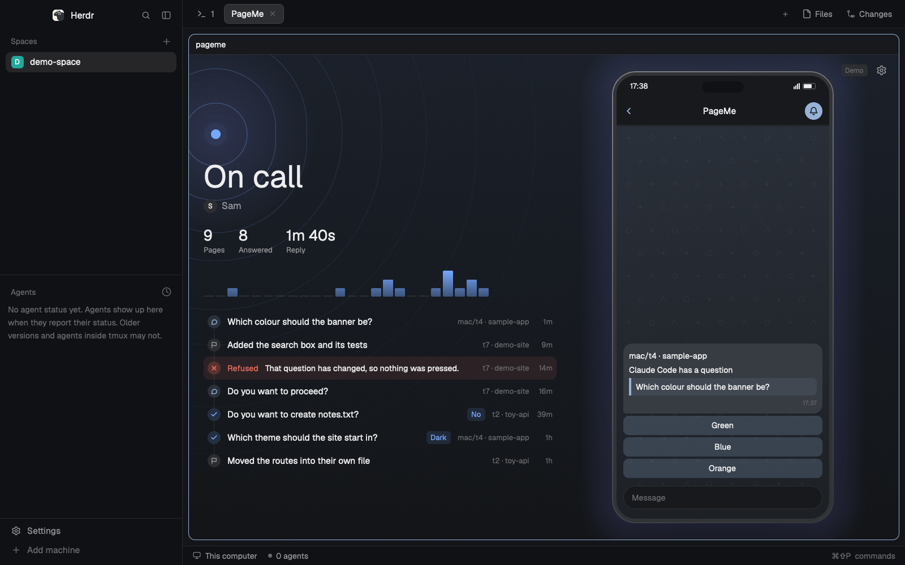

# PageMe

When an agent in Herdr is blocked, you get a Telegram message with its question and buttons, and you answer from your phone. No app to install, and no port opened.

A mod for the [Herdr](https://github.com/ogulcancelik/herdr) desktop app, with a small daemon in Python's standard library. It needs `python` on Windows or `python3` on macOS, and nothing else.

Ask your agent to add it from [herdr.dev/mods](https://herdr.dev/gallery/?type=mods), or point it at this repo. It reads [the recipe](RECIPE.md) and every file first. By hand, copy `mods/pageme` into `~/.config/herdr-app/mods` and merge `keys.json` into yours. `ctrl-shift-u` opens the panel.

## Set it up

1. In Telegram, message [@BotFather](https://t.me/BotFather), send `/newbot`, and copy the token.
2. Open the panel and press Set token. A terminal asks for it with the text hidden. It goes in Windows Credential Manager or the macOS keychain.
3. Press Start, then Pair.
4. Send the code the panel shows to your bot, within 5 minutes.

## What it does

A blocked agent sends one message: where it is, its question, and a button per option. It covers Claude Code's permission prompts and question dialogs, including several questions in a row and multi-select, and Codex's approvals. It watches this machine only until you turn on Other machines, because those screens would then go to Telegram too. Anything else shows the screen's last lines, and takes a typed reply only if the agent says it's a question and nothing on screen looks like a menu.

`/agents` lists your agents. Turn on Finished in the panel for a message when one finishes, and reply to that message to give it a new prompt.

## What it sends, and who can see it

**Screen text from blocked agents leaves your machine and goes to Telegram.** Telegram bot chats aren't end-to-end encrypted, so Telegram can read them. PageMe hides likely secrets first (tokens, keys, password-looking lines) and caps the length, but that can miss things. Don't use it where that text can't leave.

The daemon talks only to `api.telegram.org`, by long polling. It reads screens and presses keys through `hc`.

## Approving from a phone

Off by default. PageMe answers questions, and can refuse a permission prompt, but it can't approve one until you turn Approving on in the panel. Think before you do: you'd be approving commands from a small screen, and hostile text from a web page or file can shape what that screen says.

Whatever you turn on:

- "Always allow", "don't ask again" and anything that changes a session's mode are never buttons.
- Only one Telegram user can use it, bound by the pairing code. Everyone else is ignored.
- A tap works only if that terminal is still blocked on the same question, within 15 minutes, and each button works once.
- A reply can't start with `!` or `/`. A `!` runs a shell command with no approval at all.
- Every answer goes in `~/.config/herdr-pageme/audit.jsonl`.

[The threat model](docs/security.md) has the rest, including what this doesn't protect.

## Checks

`python tests/test_prompts.py`, `python -m unittest discover -s tests` and `node --test` run the checks, with a fake `hc` and a local fake Telegram server. `tests/live_check.py` tries the real daemon on a throwaway session and refuses to run on your default core.

Run for real on Windows 11 with Herdr 0.1.13: a Telegram bot, pairing, and a question answered from a phone. On macOS the panel has run with made-up data, but the daemon and keychain haven't. Codex's question dialogs haven't been tried.

MIT, see `LICENSE`.
