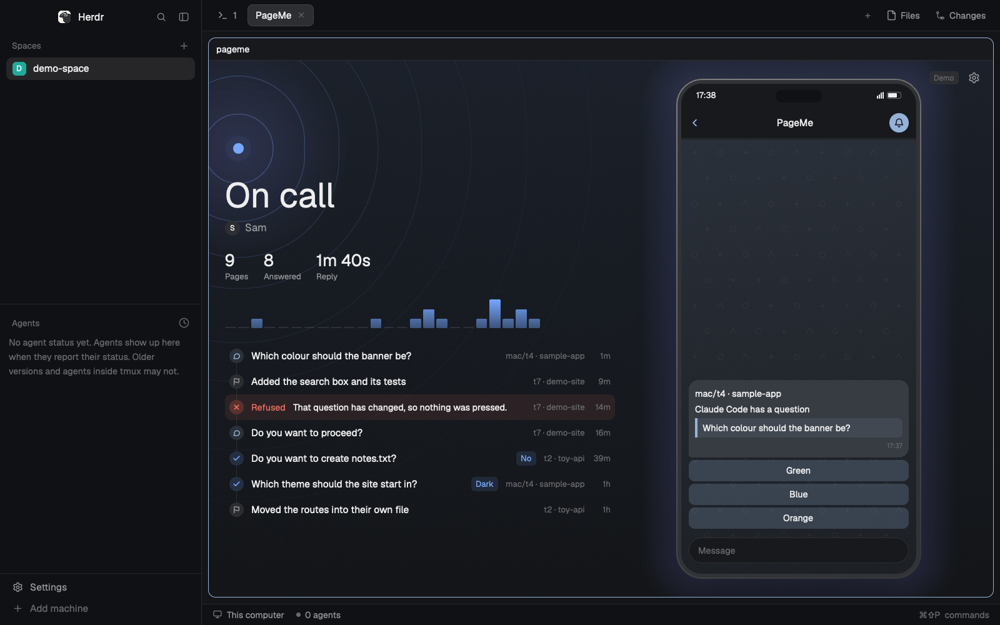

# PageMe

A panel and a small daemon. When an agent is blocked, the person gets a Telegram message with its question and a button per option, and answers from their phone. The panel leads with an on call state and a drawn phone showing the latest page as Telegram shows it, then the day's numbers and a timeline. Settings sit behind a gear. There's no app to install and no port opened: the daemon long-polls Telegram's Bot API, with a bot the person makes with @BotFather.

## What you see

A dialog, 520 by 640px, on `canvas`, with no padding of its own. It also works as a tab: at 640 units wide or more the phone moves to a column of its own, as tall as the pane allows up to 680, 24 from the top and bottom at most, 0.49 as wide as it's tall, and centred. A short pane gets a smaller phone, never a cropped one. The left column is centred against it, and its timeline is only as tall as its rows until they run out of room, then scrolls. Every size here is in the app's units and holds at any zoom. Colours are theme names only, with tints made from them. A state has one colour everywhere: On call `done`, Paused `working`, Not connected `blocked`, Stopped `dim`, setup and pairing `accent`.

**The stage,** the top 376px of the dialog, cropped. Behind everything, a wash of the state's colour fading down, 18 stacked discs of a soft glow round the beacon, and 8 thin rings spreading from it across the stage and behind the phone. The stage's last 34px fade to `canvas`, so the phone sinks into the page and the timeline needs no divider.

- **Beacon:** a 14px dot in the state's colour at the top left, with a 34px halo.
- **Hero:** the word in 46px semibold (On call, Paused, Stopped), or 32px for Not connected, which wraps. Under it a 20px circle with the first letter and the Telegram name in 14px `muted`. A problem goes under that in 12px `blocked`. Paused puts Resume here and Stopped puts Start, both primary. On call has no button.
- **Numbers:** Pages, Answered and Reply in 22px semibold over 11px `muted`, 20px apart. Reply is hidden until something was answered.
- **Hours:** 24 bars, 40px high, for pages in the last 24 hours, oldest at the left, in the state's colour fading down. An empty hour is a 2px stub in `border`. Hidden when all 24 are empty. No labels.
- **Gear:** a 30px icon button at the top right. In demo mode a small `Demo` chip sits beside it.

**The phone,** 232px wide and 470px tall, 20px from the right and 40px from the top, cropped by the stage. It shows and can't be pressed: answers are given on the real phone.

- A light behind it: 16 rounded rectangles of the state's colour at `02` alpha, 3px apart.
- The body is a filled rounded rectangle, radius 34, with a 7px bezel and a 1.5px edge whose gradient catches the light at the top left. The screen is a soft `accent` gradient with a faint scatter of small shapes, as Telegram's wallpaper has.
- A status bar with the time, signal, battery and the island. Then a 42px chat header: a back chevron, "PageMe" in 13px semibold and a bell in an `accent` circle.
- **The page:** a bubble with a 4px bottom left corner. The place in 12px semibold, the lead ("Claude Code has a question"), the question in a tinted block with a 3px `accent` bar, then the time in 9px `dim`. Under it, one 28px button per option, as Telegram's inline buttons. Once the page is over the buttons go, and a bold line says "Answered: Green", "Moved on" or "Expired".
- A question is cut at 70 characters in the cropped phone, so its buttons stay in view. The whole phone shows all of it.
- **Nothing asked yet:** the phone stands whole, the height of the dialog, with a bell in a circle and "Nothing yet" in a pill, and the timeline goes.
- **Pairing:** the code as a bubble you've sent, in `accent`, and three dots pulsing under it where the bot will answer.

**The timeline,** filling the rest and scrolling, newest first. Rows are 34px with no gap, and a 1px `border` line joins their icons. A 19px circle in a dark mix of the kind's colour holds an 11px icon: `accent` speech bubble for asked, `done` tick for answered, `muted` flag for finished, `accent` link for paired, `blocked` cross for refused. Then the text in 13px, cut with an ellipsis, the place and the time in 11px `dim`. An answer folds into the question just below it, as a chip in `done`. A refusal stands out: the whole row on a `blocked` tint, with "Refused" in 12px semibold `blocked`.

**First run.** The same stage, grown so what's under it fills the dialog, with "Set up" in the hero. Under it a card of three steps, each 46px: Bot token, Daemon and Telegram, with a number in a circle, a tick once done, and the step's button at the right. The step to do next has a `solid` number and a primary button. Under the card, in 12px `muted`, the disclosure: "Blocked agents' screen text goes to Telegram. Bot chats aren't end-to-end encrypted. Likely secrets are hidden first, and that can miss some."

**Pairing.** "Pair" in the hero and "Send this to your bot" in 14px `muted`. The card gives way to the code: 8 tiles, one a letter, in `accent` JetBrains Mono, on `surface` with an `input` border, as wide as the dialog allows. Under them a 3px bar and the time left, such as `4:32`. The disclosure stays until there's a pairing.

**Settings,** from the gear. A chevron and "Settings" in 18px semibold, then two cards on `surface`, radius 12, with 44px rows, hairlines and the value in 13px `muted`. At most 600px wide in a tab.

- Bot token: where it's kept, or Not set. Set token or Replace.
- Daemon: Running, "Running, watch mode", or Stopped. Start or Stop.
- Telegram: the person's first name, or Not paired. Pair or Unpair.
- Once paired, switches for Messages, Other machines, Finished and Approving. A switch is 36 by 21px, `done` when on.
- Turning Approving on opens a row under it on a `blocked` tint: "Approve commands from your phone?" with Turn on and Cancel.

Buttons are 30px high with 12px side padding, radius 8, 12px medium, `foreground` on `raised`. The next step is `solid_foreground` on `solid`. A button that can't work yet sits at 45% opacity.

A Telegram message for a blocked agent has the address and folder in bold (`mac/t4 · sample-app`), "Claude Code has a question", "wants approval" or "is blocked", then the screen's words in a `<pre>` block, then one line where it's needed: "Approving from Telegram is off.", "Or reply to this message with your own answer.", "Reply to this message to type into it.", "This can't be answered from here." or "PageMe is in watch mode." Buttons sit one per row. Once it's over the buttons go and a bold last line says "Answered: Dog", "Answered with your reply.", "Answered somewhere else.", "Moved on." or "Expired. Send /agents to get it again."

## How it behaves

- **Blocked:** one message. Nothing else depends on the status words: everything comes from `hc`.
- **Working, idle:** nothing is sent.
- **Done:** a message only with Finished on, and only after working or blocked.
- **Taps:** a button answers once, then the message loses its buttons. A refusal is a plain line on the tap, such as "That question has changed, so nothing was pressed."
- **Replies:** to a question with an answer field, the reply is typed there. To a finished agent's message, it's a new prompt.
- **`/agents`** lists agents, blocked first, and sends again any question that expired. `/pause` and `/resume` do what the panel does. Nothing in Telegram can turn Approving on.
- **Panel:** Set token opens a terminal that asks with the text hidden. Start, Stop, Pair, Unpair, Pause and Finished act at once. Turning Approving on asks "Approve commands from your phone?" with Turn on and Cancel. Pressing the switch again or leaving Settings cancels it. Turning it off doesn't ask. The panel reads the status every 2 seconds while it's open, and there's no other timer.
- **Motion:** all of it is native and stops when the panel isn't drawn. On call and Not connected breathe: the beacon's halo on `.loop` every 1.8 seconds and the glow every 3.6. Paused and Stopped hold still. While pairing, the three dots pulse at 1.4, 1.7 and 2 seconds, and the code's bar glides. A switch's knob slides in 140ms. A working button drops to 88% opacity on hover.

## Built from

- One mod, `mods/pageme/`, and no layout. `mod.json`: `{ "place": "none", "title": "PageMe", "overlay": { "width": 520, "height": 640 } }`. `keys.json`: `{ "global": { "ctrl-shift-u": "mod.open:pageme" } }`.
- `props`: `{ "demo": true }` uses made-up data and every control does nothing. `demo` can also name a state, for pictures: `on-call`, `answered`, `approval`, `quiet`, `paused`, `offline`, `stopped`, `no-token`, `setup` or `pairing`. `"page": "settings"` opens on Settings, and with a demo `"confirm": true` opens on the Approving question. `mod.open` takes only a name, so demo mode opens with `herdr-app do tab.new '{"name":"PageMe","mod":"pageme","props":{"demo":"paused"}}'`.
- `main.js`: the state, the poll and the commands. `logic.js`: no Herdr imports. `view.js`: the stage, hero, timeline and setup. `phone.js`: the phone. `settings.js`: Settings. `paint.js`: paths, tints and buttons. `icons/`: the SVGs.
- From `herdr`: `appHome`, `exec`, `hc`, `home`, `props`, `run`, `settings`, `theme`. From `gpui-kit`: `Background`, `PathBuilder`, `View`, `div`, `svg`. From `gpui-base`: `h_flex`, `v_flex`. Also `window.paint_path`. Command: `terminal.open`.
- Programs: `python -B <home>/mods/pageme/pageme.py <command>` on Windows, `python3` elsewhere, and `hc`. `pageme.py` commands: `status [--demo [name]]`, `token [--clear]`, `pair`, `unpair`, `pause`, `resume`, `approvals on|off`, `finished on|off`, `remote on|off`, `mode act|watch`, `run [--watch]`.
- Start: `hc run --bg --keep --no-notify --no-parent --outlive-parent --name pageme --label pageme=daemon --cwd <home> -- python -B <script> run`. Stop finds it with `hc ls --label pageme=daemon --json`, then `hc kill` and `hc rm`.
- Python, standard library only, 3.9 or newer: `pageme.py` the commands, `daemon.py` the two loops and every gate, `prompts.py` the screen reader, `policy.py` the rules, `render.py` the messages, `redact.py`, `hcli.py`, `telegram.py`, `store.py`, `credential.py`, `sample.py`.
- State in `~/.config/herdr-pageme` (`PAGEME_HOME` moves it): `state.json`, `audit.jsonl`, and lock files.
- Telegram: `getUpdates`, `sendMessage`, `editMessageText`, `answerCallbackQuery` and no others.
- `hc`: `ls --json`, `get <t> --json`, `read <t> --lines 0`, `keys <t> <keys>`, `send [--force] <t> -- <text>`, `events --json`.
- `status` also gives `latest`, the newest question (`ms`, `where`, `lead`, `text`, `options`, `state`, `answer`), and `today` (`pages`, `answered`, `reply_ms`, `hours`). Both are worked out from `prompts` and `recent` on every read, so nothing new is counted or stored apart from three fields on a question's record: `agent`, `asked` and `labels`, already cleaned, and the same words and buttons Telegram got. Nothing from a screen reaches the panel that the chat didn't get.
- `today` counts what's in `prompts`, kept for 24 hours and emptied by Unpair. `reply_ms` is the median gap between a question and its answer, among those `recent` still holds. `hours` counts pages in each of the last 24 hours.
- Icons are small SVGs in `mods/pageme/icons/`, tinted with `text_color`. The settings gear is Lucide's (ISC).

## Watch out

- **Tell the person before adding it.** It reaches the network (Telegram), runs `python` and `hc`, presses keys in terminals, and writes to `~/.config/herdr-pageme`. Blocked agents' screen text goes to Telegram, and bot chats aren't end-to-end encrypted.
- **Python, not Node, for one reason.** `ctypes` reaches Windows Credential Manager with no dependency. Node can't without a native add-on or shelling out.
- **Permission options are an allowlist.** Real prompts offer "Yes, and switch to auto mode", "Yes, and switch to accept edits" and "Yes, and use auto mode", and none of those has the word "always". Only `Yes`, `Yes, proceed` and `Yes, manually approve edits` can approve, and only `No` and two long forms can refuse.
- **`kind` isn't always there.** Claude Code reports `kind: permission` or `question`. Codex reports only `{app, state}`. A missing `kind` is treated as a permission, and a question needs both the report and the shape.
- **A trust dialog isn't blocked.** Its status is `null`, so nothing is sent.
- **Digits, not arrows.** A digit picks an option whatever the cursor is doing, in Claude Code and Codex, with no Enter. The `No` key moves between prompts, so it's read from each screen.
- **On Type something and Tell Claude what to change, a digit only moves the cursor.**
- **Multi-select:** digits toggle, `right` goes to the review page, and `1` there submits. So ticks stay in the chat, and Done presses only the digits that differ from the screen, then `right`, because a digit toggles. Ticks already on screen show in the chat. A ticked option with no button refuses Done. The review page is a new message.
- **A wizard stays blocked with the same status while its pages change,** so no event fires between them. A prompt's identity is a hash of the screen, and the screen is read again 0.8 seconds after a press.
- **`hc keys` can't type text.** It lower-cases letters, `shift+1` types `1`, and it refuses `!`, `"`, `$`, `?`, `/`, `:` and anything outside ASCII. `hc send` refuses a blocked terminal unless forced. So a typed answer is the digit, a fresh read, then `hc send --force`, and only with the cursor on that field.
- **`hc send` needs `--`** before text that could start with `-`.
- **Text never goes to a screen that might be a menu.** On a screen it can't read, PageMe needs `kind: question`, no line shaped like an option, and a reply over 3 characters. Approving doesn't change that: a typed `2` could pick "don't ask again".
- **The question shape is a footer line starting `Enter to select`,** found only below the menu. Searching the whole dialog lets an option's text fake it.
- **The hash keeps every space and line break.** Taking whitespace out makes `/tmp /cache` and `/tmp/cache` the same command. A resized pane therefore refuses a tap and asks again.
- **The panel is another process.** A check made earlier can be out of date, so spending a prompt asks the saved state again under its lock, and so does the paste after a typed answer's digit.
- **A read on Windows can lose a moment's race with a file swap.** That's not a damaged file, and wiping state over it would drop the pairing. `store.py` retries, and treats only bad JSON as damage.
- **`herdr-app check` writes `gpui-kit.d.ts` and `jsconfig.json` into the mod's folder.** They're ignored by git. Delete them before a tree scan.
- **Sessions report idle before they take input.** A send in the first seconds can be dropped, so `tests/live_check.py` waits and checks `started`.
- **Inside a terminal, `hc send` tags the text** with `<hc from=...>`. `HC_TERMINAL_ID` is taken out of the environment for every `hc` call.
- **`!` in a pasted reply runs a shell command with no prompt,** even in manual mode. That's why replies can't start with it.
- **Preview questions** draw a box beside the options, with blank lines in its column, and have no Type something row. Blanks are allowed only there, under deep indented text, with a real box beside an option.
- **A `.py` import in the mod's folder writes `__pycache__`,** which would reload the mod. Everything runs with `-B`.
- **`on_size_change` reports window pixels. `.w()`, `.h()` and `.left()` are the app's units, scaled by `settings().zoom`.** So the panel divides the reported size by the zoom (`appSize`). Skip this and it looks right at zoom 1 and breaks at Herdr's default of 1.2.
- **A path's numbers can't be trusted across zooms, so every path is written as percentages of its painted box,** through `pen` in `paint.js`. On Windows at zoom 1.2, plain numbers multiplied by the zoom came out 1.2 times too big. Percentages mean the same whatever the app does. Lengths both draw are snapped to whole pixels (`snap`), because the app rounds an element and a path doesn't.
- **The rings are children of the beacon,** so they stay centred on it wherever the layout puts it. They're painted first, so the column's text and the phone sit over them.
- **GPUI clips to rectangles, not to rounded corners.** So the phone's body, screen and edge are rounded paths, not a clipped box, and its header has its own rounded top.
- **`.loop` swings there and back, with no way to start it late.** A ripple would run backwards half the time, so the beacon breathes instead.
- **Stacked tints are the only soft light.** There's no radial gradient and no coloured shadow. Very low alpha with many layers is what keeps an edge from showing.
- **`.child(null)` isn't safe in the real app,** though the test stubs allow it. Put anything optional behind `.when`.
- **A minimised window paints nothing,** so `herdr-app shot` keeps returning its last frame. Identical frames mean that, not a stuck mod.
- **Copying the mod's files one by one reloads it part way through.** A warning like `Could not find export` during a copy is that race, and the next reload clears it.
- **A long `HERDR_APP_HOME` stops the window serving its socket:** `path must be shorter than SUN_LEN`. A private home needs a short path, such as `~/.config/hd/<slug>`.
- **macOS Python from python.org** needs its certificates installed first (`Install Certificates.command`), or HTTPS fails.
- **`--keep` never reruns the daemon.** After a reboot the panel says Stopped until someone presses Start.
- **Buttons last 15 minutes,** replies to finished agents an hour, a pairing code 5 minutes.
- **Other machines are refused in `hcli.py` too.** `Hc.remote_allowed` starts as no, and the daemon points it at the saved setting, so `get`, `read`, `keys` and `send` can't reach a `mac/t4` with the setting off, whatever called them. The gates before it are there to give a plain refusal.
- **The hash covers the whole dialog, and only the phone's copy is cut to 40 lines.** Cutting the region itself lets a changed line above the cut pass as the same question.
- **A wrapped label looks like a description,** so every line under an option counts as part of it.
- **`status.app` is untrusted.** Keep only `claude-code` and `codex`.
- **`!` and `/` are refused on every reply path,** judged by the first visible character.
- **Limits:** 20 messages a minute, 1,800 characters of screen, 40 per button, 15 lines of an unknown screen, a 2,000 character reply, 30 recent entries, 40 agents in `/agents`.
- **A plan prompt has no buttons by default.** Its only approving option that doesn't change mode is `Yes, manually approve edits`, and it has no plain No. Answer it at the keyboard.

## Done when

- `python tests/test_prompts.py`, `python -m unittest discover -s tests` and `node --test` pass.
- `herdr-app check` passes on the mod.
- With a fake `hc` and fake Telegram: a stranger gets no reply; a forged Yes presses nothing; a tap on a changed screen is refused; a second tap is refused; a reply can't answer a permission prompt.
- On a throwaway session on a private core, `tests/live_check.py` passes: questions, a wizard, multi-select, typed answers, `No`, `Yes` with Approving on, a refused `!`, and a stale tap.
- In a window, at zoom 1.0, 1.1, 1.2 and 1.5, as the 520 by 640 overlay and a tab: the whole phone is in view and centred, and the rings are centred on the beacon.
- In a window, at 520 by 640 and as a tab, in light and dark: on call, answered, nothing yet, paused, not connected, stopped, first run, pairing, Settings and the Approving question all look as described.
